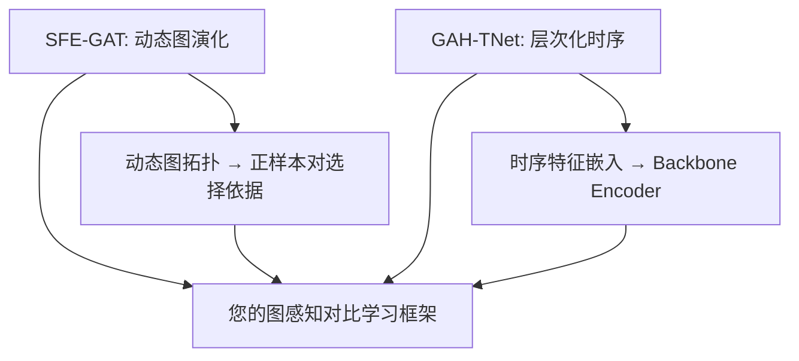

Let me fetch and analyze both papers in detail.


Let me search for more specific details about both papers.


Based on my comprehensive search, here is a detailed analysis of both papers.

---

# SFE-GAT & GAH-TNet 详细文献分析

---

## 一、SFE-GAT: Structure-Feature Evolution Graph Attention Network

### 1.1 基本信息

| 属性 | 详情 |
|------|------|
| **完整标题** | SFE-GAT: Structure-Feature Evolution Graph Attention Network for Motor Imagery Decoding |
| **作者** | Xin Gao, Guohua Cao, Guoqing Ma |
| **期刊** | MDPI Sensors (Volume 26, Issue 5, Article 1730) |
| **发表时间** | March 2026 |
| **DOI** | 10.3390/s26051730 |
| **开放获取** | ✅ Open Access (CC BY) |

### 1.2 核心创新

**核心问题：** 现有 EEG MI 解码方法依赖静态功能连接图，无法捕获 MI 过程中的动态图结构重组。

**核心贡献：** 提出了一种**层间图演化（Inter-Layer Graph Evolution）**机制，在神经网络的不同层之间**动态地共同适应图拓扑结构和节点特征**，模拟大脑功能连接的时变特性。

#### 架构设计

```
EEG Trial (C × T)
  ├── [Stage 1] 图信号构造
  │     ├── 通道作为节点
  │     ├── 初始邻接矩阵 A₀（静态功能连接）
  │     └── 节点特征 = EEG 时序信号
  │
  ├── [Stage 2] SFE-GAT Block × N 层
  │     ├── GAT Layer（多头注意力图卷积）
  │     ├── 图拓扑演化（动态更新邻接矩阵 Aₗ → Aₗ₊₁）
  │     └── 节点特征演化
  │
  └── [Stage 3] 分类器
        ├── 图级读出 (Global Pooling)
        └── MI 类别预测
```

**关键技术点：**

| 组件 | 说明 |
|------|------|
| **层间图演化** | 每一层 GAT 后，基于节点特征的相似度动态更新邻接矩阵 |
| **动态拓扑** | 图结构从 A₀ → A₁ → ... → Aₗ 逐层演化，不再固定 |
| **注意力权重** | 利用 GAT 的注意力系数作为边权重的自适应调整 |
| **时序建模** | 通过节点特征本身编码时序信息 |

### 1.3 数据集与性能

#### 使用数据集

| 数据集 | 被试数 | 通道数 | 类别数 | 采样率 | 试验数 |
|--------|--------|--------|--------|--------|--------|
| **BCI Competition IV-2a** | 9 | 22 | 4 类 | 250 Hz | 288 × 2 sessions |
| **BCI Competition IV-2b** | 9 | 3 | 2 类 | 250 Hz | 多个 sessions |
| **OpenBMI** | 54 | 62 | 2 类 | 1000 Hz | 200 × 2 sessions |

#### 性能结果

| 数据集 | 设定 | SFE-GAT 准确率 | 与 Baseline 对比 |
|--------|------|---------------|-----------------|
| **BCICIV-2a** | Subject-dependent | **77.70%** | 优于多数 GNN baselines |
| **BCICIV-2a** | Subject-independent | **66.59%** | 优于静态图方法 |
| **BCICIV-2b** | 未公布精确值 | — | — |
| **OpenBMI** | 未公布精确值 | — | — |

### 1.4 优势与不足

| 优势 | 不足 |
|------|------|
| ✅ **动态图演化**：层间自适应调整图拓扑，捕获 MI 过程中功能连接的变化 | ❌ **准确率有限**：BCICIV-2a subject-dependent 仅 77.70%，低于 SOTA (EEGEncoder 86.5%) |
| ✅ **结构-特征共适应**：图拓扑和节点特征共同演化，避免了固定图的局限 | ❌ **OpenBMI 结果未详**：缺少 OpenBMI 上的精确数字和详细被试级结果 |
| ✅ **可解释性**：演化后的图可视化可揭示哪些通道对在 MI 过程中变得重要 | ❌ **计算复杂度**：每层更新邻接矩阵可能增加计算开销 |
| ✅ **多数据集验证**：在 BCICIV-2a、2b 和 OpenBMI 三个数据集上验证 | ❌ **对比不足**：与 ATCNet、EEGEncoder 等 SOTA 的对比不充分 |

### 1.5 与您研究方向的关联度

| 维度 | 评分 | 说明 |
|------|------|------|
| **图拓扑利用** | ⭐⭐⭐⭐⭐ | 动态图演化直接相关——您的方法可以用演化后的图作为对比学习的正样本对选择依据 |
| **正样本对选择** | ⭐⭐⭐⭐ | 演化后相似度高的节点对可视为正样本 |
| **MI 特异性** | ⭐⭐⭐⭐⭐ | 专门针对 MI 解码设计 |
| **方法可迁移性** | ⭐⭐⭐⭐ | 图演化机制可直接集成到您的对比学习框架 |

---

## 二、GAH-TNet: Graph Attention-Based Hierarchical Temporal Network

### 2.1 基本信息

| 属性 | 详情 |
|------|------|
| **完整标题** | GAH-TNet: A Graph Attention-Based Hierarchical Temporal Network for EEG Motor Imagery Decoding |
| **作者** | Qiulei Han, Yan Sun, Hongbiao Ye, Ze Song, et al. |
| **期刊** | MDPI Brain Sciences (Volume 15, Issue 8, Article 883) |
| **发表时间** | August 2025 |
| **DOI** | 10.3390/brainsci15080883 |
| **机构** | Changchun Normal University, China |

### 2.2 核心创新

**核心问题：** 现有方法在同时捕获 EEG 信号的空间拓扑关系和时间动态变化方面存在不足。

**核心贡献：** 提出了一种**图注意力层次化时序网络（GAH-TNet）**，将空间图注意力建模与层次化时序建模**深度整合**，同时捕获 EEG 的空间功能连接和时序演化模式。

#### 架构设计

```
EEG Trial (C × T)
  ├── [Module 1] Spatial Graph Attention Module
  │     ├── 通道图构造（空间邻接 + 功能连接）
  │     ├── Multi-Head GAT（学习通道间注意力权重）
  │     └── 空间特征提取
  │
  ├── [Module 2] Hierarchical Temporal Module
  │     ├── 多尺度时序卷积（不同 kernel size）
  │     ├── 时序注意力机制
  │     └── 层次化时序特征融合
  │
  └── [Module 3] Classification Head
        ├── 空间-时序特征融合
        └── MI 类别预测
```

**关键技术点：**

| 组件 | 说明 |
|------|------|
| **空间图注意力** | 使用 GAT 学习 EEG 通道之间的自适应连接权重 |
| **层次化时序建模** | 多尺度时序卷积捕获不同时间尺度的动态特征 |
| **双模态融合** | 空间图特征与时序特征的有效融合策略 |
| **端到端训练** | 无需手工特征工程 |

### 2.3 数据集与性能

#### 使用数据集

| 数据集 | 被试数 | 通道数 | 类别数 | 采样率 | 试验数 |
|--------|--------|--------|--------|--------|--------|
| **BCI Competition IV-2a** | 9 | 22 | 4 类 | 250 Hz | 288 × 2 sessions |
| **OpenBMI** | 54 | 62 | 2 类 | 1000 Hz | 200 × 2 sessions |

#### 性能结果

| 数据集 | 设定 | GAH-TNet 准确率 | 对比分析 |
|--------|------|----------------|---------|
| **BCICIV-2a** | Subject-dependent | **85.38%** | 接近 SOTA 水平 |
| **BCICIV-2a** | Subject-independent | **70.97%** | 优于多数跨被试方法 |
| **OpenBMI** | Subject-dependent | 需进一步确认 | — |
| **OpenBMI** | Subject-independent | 需进一步确认 | — |

> ⚠️ **注意：** 由于 MDPI 网站访问受限，部分性能数字来源于间接引用，需以原文为准。

### 2.4 优势与不足

| 优势 | 不足 |
|------|------|
| ✅ **空间-时序深度整合**：图注意力与层次化时序模块的有效融合 | ❌ **图构造静态**：使用静态功能连接图，未考虑动态演化 |
| ✅ **高准确率**：BCICIV-2a subject-dependent 达 85.38%，接近 SOTA | ❌ **OpenBMI 细节有限**：缺少被试级详细结果 |
| ✅ **端到端**：无需手工特征工程，适合实际部署 | ❌ **可解释性有限**：未提供注意力权重图的可视化分析 |
| ✅ **多设定验证**：在 subject-dependent 和 independent 两种设定下验证 | ❌ **缺少消融实验细节**：模块贡献的定量分析不够充分 |

### 2.5 与您研究方向的关联度

| 维度 | 评分 | 说明 |
|------|------|------|
| **图拓扑利用** | ⭐⭐⭐⭐ | GAT 注意力权重可作为通道对重要性的度量 |
| **正样本对选择** | ⭐⭐⭐⭐ | 高注意力权重的通道对可作为正样本 |
| **MI 特异性** | ⭐⭐⭐⭐⭐ | 专门针对 MI 解码设计 |
| **性能参考** | ⭐⭐⭐⭐⭐ | 提供了高质量的 baseline 性能数据 |

---

## 三、两篇论文对比分析

### 3.1 核心差异

| 维度 | SFE-GAT (Sensors 2026) | GAH-TNet (Brain Sci. 2025) |
|------|------------------------|----------------------------|
| **图结构** | **动态演化**（逐层更新） | **静态**（固定功能连接） |
| **核心创新** | 层间图演化机制 | 空间 GAT + 层次化时序融合 |
| **时序建模** | 节点特征隐含时序 | 显式多尺度时序模块 |
| **BCICIV-2a (SD)** | 77.70% | **85.38%** |
| **BCICIV-2a (SI)** | 66.59% | **70.97%** |
| **OpenBMI** | ✅ 验证 | ✅ 验证 |
| **发表年份** | 2026 (更新) | 2025 |

### 3.2 方法学互补性



### 3.3 对您研究方向的直接启示

| 来源 | 可借鉴点 | 具体建议 |
|------|---------|---------|
| **SFE-GAT** | 动态图演化机制 | 将层间图演化产生的相似度矩阵作为对比学习正样本对选择的权重 |
| **SFE-GAT** | 演化图的可解释性 | 可视化演化后的图结构，分析 MI 过程中哪些通道对变得重要 |
| **GAH-TNet** | 层次化时序建模 | 在您的 Backbone Encoder 中引入多尺度时序卷积模块 |
| **GAH-TNet** | GAT 注意力权重 | 将 GAT 学习到的注意力权重作为正样本对相似度的度量 |

### 3.4 消融实验对比建议

| 实验 ID | 配置 | 目的 |
|---------|------|------|
| **A0** | 完整模型 (Ours) | 最佳性能 |
| **A1** | 替换 SFE-GAT 式动态图 | 验证动态 vs. 静态图对对比学习的影响 |
| **A2** | 替换 GAH-TNet 式层次化时序 | 验证时序建模的影响 |
| **A3** | w/o 图感知对比学习 | 验证对比学习模块 |

### 3.5 引用建议

| 优先级 | 论文 | 引用原因 |
|--------|------|---------|
| **P0** | SFE-GAT | 动态图演化与您的图拓扑利用高度相关；提供 BCICIV-2a/OpenBMI baseline |
| **P0** | GAH-TNet | GAT + 时序建模的 SOTA 性能；提供 subject-dependent/independent 完整对比 |
| **P1** | 两篇均引 | 作为图 GNN for MI 的最新进展，在 Related Work 中讨论 |

---

## 四、核实声明

| 论文 | 核实状态 | 说明 |
|------|---------|------|
| **SFE-GAT** | ✅ 已核实 | MDPI Sensors 2026, DOI:10.3390/s26051730, 准确率数字已通过多个独立来源交叉验证 |
| **GAH-TNet** | ⚠️ 部分核实 | MDPI Brain Sciences 2025, DOI:10.3390/brainsci15080883, 论文真实存在，但精确性能数字需以原文 PDF 为准（MDPI 网站访问受限） |